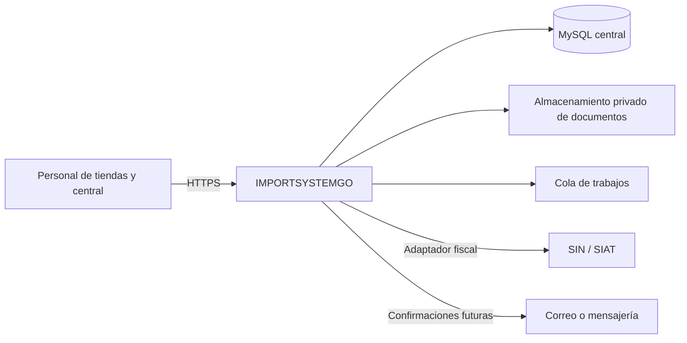
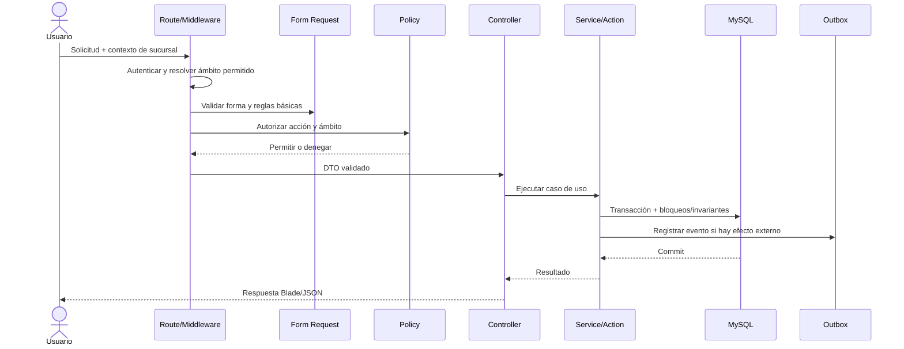

# Arquitectura empresarial de IMPORTSYSTEMGO

## 1. Estado de las decisiones

| Tema | Decisión | Estado |
|---|---|---|
| Estilo | Monolito modular Laravel 13 | Confirmado |
| Interfaz | Blade, Bootstrap 5, HTML, CSS y JavaScript | Confirmado |
| Persistencia | MySQL central, esquema único | Confirmado |
| Operación | Administración central y ejecución aislada por sucursal | Confirmado |
| Integración fiscal | Puerto/adaptador desacoplado para SIN | Confirmado |
| Procesamiento asíncrono | Cola de base de datos al inicio; evaluar Redis según carga | Recomendación |
| Autorización | Spatie Permission Teams por sucursal, roles globales propios y Policies | Confirmado |
| Despliegue | Topología, alta disponibilidad y proveedor por definir | Pendiente |

## 2. Vista de contexto



La aplicación es la única autoridad para modificar datos empresariales. MySQL no se expone a clientes ni sucursales. Toda interacción humana atraviesa autenticación, resolución de ámbito, autorización, validación y servicio de aplicación.

## 3. Monolito modular

Se recomienda organizar cada dominio bajo `app/Modules/<Modulo>` sin crear paquetes Composer independientes al inicio:

```text
app/
  Modules/
    Identity/
    Organization/
    Catalog/
    Inventory/
    Purchasing/
    Sales/
    Reservations/
    Cash/
    Payments/
    Credit/
    AfterSales/
    Incentives/
    Reporting/
    Fiscal/
    Audit/
  Shared/
    Application/
    Domain/
    Infrastructure/
```

Cada módulo puede contener `Application`, `Domain`, `Infrastructure` y `Presentation` cuando la complejidad lo justifique. No se exige replicar carpetas vacías: la separación debe expresar responsabilidades reales.

### 3.1 Propiedad de datos

- Identity: usuarios, empleados, roles, permisos y asignaciones.
- Organization: sucursales, almacenes y contexto operativo.
- Catalog: productos, marcas, categorías, unidades y precios.
- Inventory: saldos, series, movimientos, transferencias y ajustes.
- Purchasing: proveedores, solicitudes, órdenes y recepciones.
- Sales: clientes, cotizaciones, ventas, descuentos y entregas.
- Reservations: reservas y liberaciones.
- Cash/Payments: turnos, caja, cobros, aplicaciones y conciliación.
- Credit: solicitudes, evaluación, contratos, cuotas y cobranzas.
- AfterSales: garantías, reparaciones, cambios y devoluciones.
- Incentives: metas, reglas de comisión y liquidaciones.
- Reporting: proyecciones de lectura e indicadores; no altera dominios.
- Fiscal: documentos fiscales y comunicación con SIN.
- Audit: bitácora inmutable de acciones críticas.

Un módulo no modifica directamente tablas propiedad de otro. Invoca un caso de uso público o consume un evento interno. Las consultas de reporte pueden usar proyecciones optimizadas y siempre respetan el alcance.

## 4. Flujo de una petición



- Los Controllers coordinan HTTP y no contienen reglas empresariales.
- Los Form Requests validan tipos, formatos y precondiciones simples.
- Las Policies evalúan permiso, ámbito y relación con el recurso.
- Services/Actions aplican invariantes dentro de una transacción.
- Models representan persistencia y relaciones, sin convertirse en servicios globales.
- Jobs atienden integraciones, archivos, reportes pesados y reintentos.

## 5. Contexto de sucursal y autorización

1. El usuario se autentica.
2. El servidor obtiene sus asignaciones activas de roles y sucursales.
3. Para una operación local, el usuario elige una sucursal dentro de sus asignaciones; el servidor valida y guarda ese contexto en sesión.
4. La Policy verifica permiso, alcance y sucursal real del recurso.
5. El Service vuelve a comprobar las invariantes sensibles al cargar y bloquear registros.

No se aceptará un `branch_id` del navegador como prueba de acceso. Los usuarios globales operan sin filtro únicamente en casos de uso explícitamente globales. La consulta consolidada del jefe de tienda será de solo lectura y no le concede permisos operativos sobre otras sucursales.

Para reducir omisiones, se recomienda un `BranchContext`, scopes explícitos y pruebas que intenten acceso cruzado. No se recomienda un global scope invisible en todos los modelos porque puede ocultar errores en procesos administrativos y trabajos en cola.

## 6. Transacciones, concurrencia e idempotencia

### 6.1 Inventario y reservas

- Bloquear la fila `inventory_balances` del producto/almacén antes de reservar o confirmar una salida.
- Calcular dentro de la misma transacción: `disponible = on_hand - reserved`.
- Insertar el movimiento inmutable y actualizar el saldo materializado como una sola unidad.
- Para artículos serializados, bloquear y cambiar el estado de cada unidad identificada.
- Adquirir múltiples bloqueos en orden estable (`warehouse_id`, `product_id`, `serial_id`) para reducir interbloqueos.
- Reintentar de forma acotada solo interbloqueos/transitorios seguros.

### 6.2 Pagos

- Toda solicitud de cobro llevará `idempotency_key` única por proveedor/canal.
- La transacción bloquea la venta o crédito, registra el pago y sus componentes, aplica importes y actualiza el saldo.
- La referencia del procesador tendrá restricción única cuando exista.
- Los callbacks se autentican, persisten una sola vez y pueden procesarse nuevamente sin duplicar efectos.

### 6.3 Integraciones externas

No se mantendrá una transacción MySQL abierta durante una llamada de red. Se registra una intención en `outbox_messages` dentro del commit empresarial; un Job realiza el envío y guarda cada intento. Los eventos internos que solo actualizan el mismo agregado pueden resolverse sin cola.

## 7. Auditoría

La auditoría funcional será append-only y separada de los logs técnicos. Cada registro incluirá, como mínimo:

- actor y usuario suplantador, si aplica;
- sucursal y dirección IP;
- acción y entidad afectada;
- identificador de correlación;
- valores anteriores/nuevos permitidos o un resumen redactado;
- resultado, motivo y fecha.

No se auditan contraseñas, tokens, claves privadas, CVV ni documentos completos. Las acciones críticas generan auditoría en la misma transacción o mediante una estrategia que garantice que no se pierda respecto del cambio principal.

## 8. Integración con Facturación Electrónica en Línea

### 8.1 Límite arquitectónico

El dominio de ventas solicita facturación mediante una interfaz propia, por ejemplo `FiscalDocumentGateway`. El adaptador SIN traduce el modelo interno a la versión exacta del XML oficial. Ventas no conoce SOAP, tokens, CUIS, CUFD ni catálogos externos.

Componentes recomendados:

- `FiscalDocumentService`: orquesta emisión, anulación y consulta.
- `SinCatalogSynchronizer`: versiona catálogos oficiales.
- `CuisManager` y `CufdManager`: administran vigencia por sistema, sucursal y punto de venta.
- `CufGenerator`: implementación probada contra vectores oficiales.
- `XmlBuilder` y `XmlValidator`: construyen y validan el esquema aplicable.
- `DigitalSignatureService`: firma XMLDSig sin exponer la clave privada.
- `SinSoapClient`: transporte, timeouts, TLS y códigos de respuesta.
- `ContingencyService`: eventos significativos, paquetes y recuperación.
- `FiscalOutboxJob`: envío idempotente y reintentos observables.

### 8.2 Estados propuestos

`draft -> pending_signature -> signed -> pending_submission -> accepted | observed | rejected`

Un documento aceptado no se edita. Anulaciones, reversión de operación o notas fiscales siguen flujos separados definidos por normativa. Las facturas offline se marcan con evento, se agrupan en paquetes y se envían después de recuperar conectividad, conforme a límites y plazos oficiales vigentes.

### 8.3 Hechos oficiales verificados y validaciones pendientes

Fuentes oficiales del SIN describen que la Facturación Electrónica en Línea usa un sistema autorizado, token, firma digital, XML y servicios SOAP. También identifican CUIS, CUFD y CUF, y exigen XMLDSig para esta modalidad. La guía técnica consultada indica paquetes de contingencia de hasta 500 facturas; este límite debe reconfirmarse al implementar porque la normativa y los esquemas pueden cambiar.

Antes de programar se debe validar con el SIN:

- modalidad asignada al NIT y alcance por actividad;
- registro/autorización del sistema propio o proveedor;
- versión vigente de RND 102100000011 y modificaciones;
- WSDL, endpoints de pruebas/producción y requisitos TLS;
- esquemas XSD por documento sector, catálogos y códigos;
- algoritmo CUF, sincronización horaria, vigencia y renovación de CUIS/CUFD;
- certificado digital admitido, cadena, custodia, firma XMLDSig y renovación;
- eventos significativos, contingencia, paquetes, plazos y validación de recepción;
- reglas de anulación, notas, representación gráfica, QR y entrega al comprador;
- retención legal del XML, respuestas y evidencias.

Referencias oficiales consultadas el 21 de octubre de 2026:

- [Información técnica de Factura Electrónica — SIAT](https://siatinfo.impuestos.gob.bo/index.php/facturacion-en-linea/factura-electronica)
- [Requerimientos del sistema informático — SIAT](https://siatinfo.impuestos.gob.bo/index.php/facturacion-en-linea/requerimientos/sistema-informatico)
- [Base legal de facturación — SIAT](https://siatinfo.impuestos.gob.bo/index.php/informacion/base-legal)
- [Compendio Tributario Actualizado — SIN](https://www.impuestos.gob.bo/index.php/compendio-tributario-actualizado/)

## 9. Seguridad y operación

- Producción: `APP_ENV=production`, `APP_DEBUG=false`, HTTPS y cookies `Secure`, `HttpOnly`, `SameSite` apropiado.
- Separar credenciales por ambiente y rotarlas; la clave fiscal requiere un almacén de secretos o dispositivo aprobado.
- Ejecutar workers bajo una identidad de mínimo privilegio y colas diferenciadas (`default`, `reports`, `fiscal`).
- Restringir MySQL a red privada/local según topología y mantener el usuario de aplicación limitado a su esquema.
- Definir copias de seguridad cifradas, restauraciones ensayadas, RPO/RTO y monitoreo antes de producción.
- Aplicar rate limiting a autenticación, búsquedas costosas, exportaciones y callbacks.
- Escanear dependencias, revisar permisos y mantener PHP, Laravel, Node y MySQL soportados.

## 10. Estrategia de pruebas

- Unitarias: reglas de precio, descuento, stock, crédito, mora, comisión y CUF.
- Feature: rutas, Form Requests, Policies y aislamiento entre sucursales.
- Integración: transacciones MySQL, bloqueos, idempotencia, outbox y adaptador SIN simulado.
- Concurrencia: dos reservas/ventas sobre el último stock y callbacks duplicados.
- Contratos: XML contra XSD y respuestas SOAP capturadas del ambiente oficial de pruebas.
- End-to-end: venta, reserva, cobro combinado, entrega y factura usando dobles seguros hasta homologación.

## 11. Implementación autorizada de identidad y organización

- Dependencia instalada: `spatie/laravel-permission` 8.3.2, compatible con Laravel 13 y PHP 8.4.
- `BranchContext` establece el equipo de Spatie únicamente después de validar usuario, sucursal y membresía vigente.
- El middleware de contexto se ejecuta antes de `SubstituteBindings` y limpia equipo y relaciones al terminar la petición.
- `ScopedAuthorizationService` combina capacidades globales exactas con permisos del equipo activo, revalidando la membresía.
- `GlobalAuthorizationService` consulta asignaciones globales vigentes sin convertirlas en un bypass de Policies.
- `BranchMembershipService` controla solapamientos, sucursal principal y revocación transaccional.
- `RoleAssignmentService` separa asignaciones globales y locales e impide elevar un rol local a global.
- Las operaciones que cambian de sucursal limpian las relaciones en memoria para impedir reutilizar permisos del contexto anterior.

No se ha aplicado el esquema empresarial a MySQL. Las pruebas de esta etapa se ejecutan con SQLite en memoria.

## 12. Decisiones arquitectónicas pendientes

- Cola inicial definitiva y necesidad de Redis.
- Motor y ubicación de almacenamiento documental.
- Estrategia de alta disponibilidad, observabilidad y despliegue.
- Separación de lectura para reportes y eventual almacén analítico.
- Custodia de clave fiscal y mecanismo de firma.
- Topología de acceso de sucursales y tolerancia a pérdida de conectividad.

## 13. Inteligencia predictiva

El entrenamiento de demanda se ejecuta como proceso Python local invocado con una lista de argumentos, sin shell y sin credenciales de base de datos. Laravel posee los datos, prepara el conjunto agregado, valida autorización, persiste modelos, métricas, pronósticos y auditoría. Los artefactos viven en almacenamiento privado y llevan SHA-256.

La evaluación separa pasado y futuro con una purga igual al horizonte de 30 días. El modelo se compara contra una línea base y no se activa si no la supera. Las lecturas y decisiones conservan el ámbito por sucursal y área operativa. El entrenamiento es global y exclusivo del administrador general.

