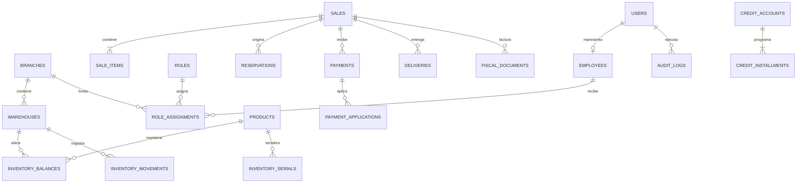

# Modelo de datos propuesto

## 1. Naturaleza del documento

Este documento conserva el diseño lógico global. El núcleo de Fase D ya está aplicado en principal (19 tablas, 10 migraciones); el resto no debe confundirse con tablas existentes. E1-001 añade una migración preparada de auditoría, ejecutada solo en pruebas. Consultar `PROGRESO.md` para estado real. Ninguna descripción autoriza por sí sola migraciones principales.

## 2. Convenciones

- MySQL/InnoDB, `utf8mb4`, claves primarias `BIGINT UNSIGNED` internas.
- Códigos públicos o empresariales con restricciones `UNIQUE`; no exponer IDs secuenciales cuando sea riesgoso.
- Claves foráneas explícitas e indexadas. `RESTRICT` para historia; `CASCADE` solo en hijos sin vida independiente.
- Timestamps de Laravel y, cuando corresponda, `created_by`, `updated_by`, `approved_by`.
- Estados mediante columnas string controladas por dominio o catálogos estables; no usar `ENUM` hasta confirmar su volatilidad.
- Dinero: `DECIMAL(19,4)`; tasas: `DECIMAL(12,8)`; cantidades: `DECIMAL(18,6)`. Moneda ISO 4217 `CHAR(3)`.
- Totales guardados son instantáneas verificables, no sustituyen los detalles que los originan.
- Los documentos operativos confirmados no se borran: se cancelan o compensan.
- PII y documentos privados se minimizan, cifran cuando corresponda y acceden mediante autorización.

## 3. Vista general



## 4. Organización, identidad y permisos

### `branches`

- `id`, `code UNIQUE`, `name`, `type` (`central`, `store`), `legal_address`, `timezone`, `is_active`, timestamps.
- Índices: `(is_active, name)`.
- Pendiente: códigos fiscales de sucursal y puntos de venta se modelarán aparte por sus ciclos propios.

### `warehouses`

- `id`, `branch_id NULL FK branches RESTRICT`, `code UNIQUE`, `name`, `type`, `is_active`, timestamps.
- Decisión aprobada: `branch_id` obligatorio, también para el almacén central, asociado a una sucursal de tipo `central`.
- Índice: `(branch_id, is_active)`.

### `users` y `employees`

- `users`: conservar identidad Laravel; agregar `status`, `primary_branch_id NULL`, `last_login_at` y `password_changed_at`. Una sola FK evita múltiples sucursales principales; el servicio exige membresía vigente.
- `employees`: `id`, `user_id UNIQUE NULL FK`, `employee_code UNIQUE`, nombres, datos laborales mínimos, `home_branch_id FK`, `status`, fechas laborales, timestamps.
- No usar email como clave de empleado ni guardar datos innecesarios.

### `branch_user_memberships`

- Registra `user_id`, `branch_id`, inicio, finalización, otorgante, revocador y motivo.
- Un índice único condicionado garantiza una sola membresía sin finalización por usuario/sucursal.
- El servicio evita cualquier periodo solapado y revoca roles locales al finalizar la membresía.

### RBAC Spatie y `global_user_roles`

- Spatie Teams crea `permissions`, `roles`, `role_has_permissions`, `model_has_roles` y `model_has_permissions`.
- `roles` incorpora `branch_id NULL`, `scope_type` y `guard_name=web`. Una columna generada normaliza `NULL` a cero para garantizar en MySQL la unicidad de roles globales.
- `model_has_roles.branch_id` es obligatorio y referencia `branches`; el servicio exige además una membresía vigente.
- `model_has_permissions` se conserva por compatibilidad, pero la aplicación prohíbe asignaciones directas.
- `global_user_roles` guarda roles globales con vigencia, otorgante, revocador y motivo. Un índice condicionado impide dos asignaciones abiertas iguales.
- MySQL impone periodos temporales válidos, fechas laborales coherentes y valores de alcance válidos mediante restricciones `CHECK`.
- Las columnas generadas `active_membership`, `active_assignment` y `scope_branch_id` resuelven la unicidad de asignaciones abiertas y de nombres cuando intervienen valores `NULL`.
- La correspondencia entre `global_user_roles.role_id` y un rol global no puede expresarse con una FK ordinaria y se garantiza en servicios transaccionales y pruebas.

## 5. Catálogo

### `brands`, `categories`, `units`

- Código único, nombre, estado y timestamps.
- `categories.parent_id NULL` permite jerarquía; impedir ciclos en servicio.

### `products`

- `id`, `sku UNIQUE`, `barcode NULL`, `name`, `description`, `brand_id NULL FK`, `category_id FK`, `unit_id FK`.
- `tracking_mode`: `quantity`, `serial`, `imei`; `is_active`, `allow_fractional_quantity`.
- `list_price DECIMAL(19,4)`, `currency CHAR(3)`, `tax_category_code NULL`, timestamps.
- `CHECK list_price >= 0`; el modo serial/IMEI exige cantidades enteras por regla de dominio.
- Índices: `(category_id, is_active)`, `(brand_id, is_active)`, barcode único si no es nulo.

### Historial de precios recomendado

`product_prices(id, product_id, amount, currency, valid_from, valid_to, created_by)` conserva cambios aun cuando exista precio vigente en `products`. Restricción/servicio impide periodos solapados. Confirmar en Fase D si el “precio único” requiere historial o solo valor actual.

## 6. Inventario físico, reservas y disponibilidad

### `inventory_balances`

- `warehouse_id FK`, `product_id FK`, `on_hand DECIMAL(18,6)`, `reserved DECIMAL(18,6)`, `version BIGINT`, timestamps.
- PK/UNIQUE `(warehouse_id, product_id)`.
- `CHECK on_hand >= 0`, `reserved >= 0`, `reserved <= on_hand`, salvo que una política futura y explícita autorice otra condición.
- Es un saldo materializado para bloqueo y rendimiento; debe reconciliarse contra el kardex.

### `inventory_serials`

- `id`, `product_id FK`, `serial_number`, `imei1 NULL`, `imei2 NULL`, `warehouse_id NULL FK`, `status`, `received_at`, `sold_at NULL`, timestamps.
- Unicidad global recomendada para `(product_id, serial_number)` y para cada IMEI no nulo; confirmar si los seriales son globalmente únicos entre productos.
- Estados propuestos: `available`, `reserved`, `in_transfer`, `sold`, `service`, `returned`, `written_off`.

### `inventory_movements`

- Encabezado: `id`, `public_id UNIQUE`, `warehouse_id FK`, `product_id FK`, `serial_id NULL FK`, `movement_type`, `quantity_signed DECIMAL(18,6)`, `unit_cost DECIMAL(19,4) NULL`, `occurred_at`, `reference_type`, `reference_id`, `correlation_id`, `created_by`, `reversal_of_id NULL FK`, timestamps.
- Append-only. Correcciones mediante movimiento inverso enlazado.
- Índices: `(warehouse_id, product_id, occurred_at, id)`, `(reference_type, reference_id)`, `(serial_id, occurred_at)`, `(correlation_id)`.
- Para productos serializados, `ABS(quantity_signed)=1` y `serial_id` obligatorio.

### `reservations` y `reservation_items`

- `reservations`: `id`, `public_id UNIQUE`, `sale_id NULL FK`, `branch_id FK`, `warehouse_id FK`, `status`, `reserved_at`, `released_at NULL`, `released_by NULL`, `release_reason NULL`, timestamps.
- `reservation_items`: `id`, `reservation_id FK`, `product_id FK`, `serial_id NULL FK`, `quantity DECIMAL(18,6)`, `fulfilled_quantity`, timestamps.
- Índices: `(warehouse_id, status, reserved_at)`, `(sale_id)`, `(product_id, status derivado mediante join)`.
- Estados: `active`, `partially_fulfilled`, `fulfilled`, `released`, `cancelled`.
- La liberación es manual según requisito confirmado; una expiración automática permanece pendiente.

### Fórmula de disponibilidad

```text
stock_físico = inventory_balances.on_hand
stock_reservado = inventory_balances.reserved
stock_disponible = stock_físico - stock_reservado
```

Una reserva no es un movimiento físico. Cumplir una reserva reduce `reserved` y genera la salida física; liberar solo reduce `reserved`. Una transferencia despachada genera salida del origen y stock en tránsito; la recepción genera entrada en destino.

### `stock_transfers`, `stock_transfer_items`, `stock_transfer_receipts`

- Transferencia: origen/destino distintos, solicitante, aprobador, estado, fechas y motivo.
- Ítems: producto, cantidad solicitada/aprobada/despachada/recibida.
- Recepciones: permiten parcialidad y enlazan movimientos/series recibidas.
- Índices por `(source_warehouse_id, status)` y `(destination_warehouse_id, status)`.
- Estados propuestos: `draft`, `requested`, `approved`, `dispatched`, `partially_received`, `received`, `cancelled`.

## 7. Compras y proveedores

### `suppliers`

- `id`, `code UNIQUE`, razón social, identificación tributaria indexada, contacto, estado, timestamps.

### `purchase_requests` y `purchase_request_items`

- Solicitud: sucursal solicitante, solicitante, estado, justificación, totales estimados y moneda.
- Ítems: producto, cantidad, costo estimado, almacén destino.
- Aprobación separada en `approvals` para conservar decisión, regla, actor, fecha y comentario.

### `purchase_orders` y `purchase_order_items`

- Orden: proveedor, moneda, subtotal, descuentos, impuestos, total, estado y fechas.
- Ítems con descripción y costos congelados como instantánea.
- `CHECK` de importes no negativos y total consistente validado en dominio.

### `purchase_receipts` y `purchase_receipt_items`

- Recepción enlaza orden, almacén, receptor, fecha y estado.
- Ítems registran cantidad recibida y series; la suma no excede cantidad ordenada salvo tolerancia aprobada.
- Cada confirmación crea movimientos de inventario dentro de la misma transacción.

## 8. Clientes, ventas, reservas y entregas

### `customers`

- `id`, `public_id UNIQUE`, tipo, nombre/razón social, identificación y complemento, email/teléfono, dirección, estado, timestamps.
- Índices normalizados para búsqueda; política de unicidad de documento pendiente por tipo/país.

### `quotes`, `quote_items`

- Sucursal, cliente opcional, vendedor, vigencia, moneda, totales, estado.
- Ítems congelan SKU/descripción/precio; una conversión crea venta y conserva referencia.

### `sales`

- `id`, `public_id UNIQUE`, `branch_id FK`, `customer_id NULL FK`, `seller_employee_id FK`, `status`, `currency`, `subtotal`, `discount_total`, `tax_total`, `grand_total`, `paid_total`, `credit_total`, `sold_at`, `version`, timestamps.
- Índices: `(branch_id, sold_at)`, `(seller_employee_id, sold_at)`, `(customer_id, sold_at)`, `(status, sold_at)`.
- `CHECK` importes >= 0 y `grand_total = subtotal - discount_total + tax_total` validado también en servicio.

### `sale_items`

- `sale_id FK`, `product_id FK`, SKU/descripción instantáneos, cantidad, precio lista, descuento, precio neto, impuesto y total.
- Índice `(sale_id, product_id)`; no se actualiza el precio por cambios posteriores de catálogo.

### `discount_authorizations`

- Venta/ítem, solicitado por, aprobado/rechazado por, regla/umbral, valores solicitado/aprobado, motivo, estado y timestamps.
- Restricción: solicitante no puede aprobar su propia solicitud cuando aplique segregación.

### `deliveries` y `delivery_items`

- Venta, tipo (`store`, `warehouse`, `scheduled`), almacén, dirección/fecha programada, estado, receptor y prueba de entrega.
- Ítems permiten entregas parciales y relacionan series.
- Confirmar entrega genera/relaciona salidas físicas, consumiendo primero la reserva aplicable.

### Devoluciones

`sales_returns` y `sales_return_items` conservan venta original, autorización del jefe de tienda, motivo, condición del artículo, decisión de reintegro y movimientos compensatorios. Nunca se elimina el ítem vendido.

## 9. Caja y pagos

### `cash_registers` y `cash_sessions`

- Caja física/lógica pertenece a sucursal.
- Sesión: caja, cajero, apertura, fondo inicial, cierre, totales esperados/contados, diferencia, estado.
- Índice/garantía de una sesión abierta por caja y una sesión individual activa por cajero según política a confirmar.

### `cash_movements`

- Sesión, tipo (`opening`, `sale_income`, `credit_collection`, `expense`, `withdrawal`, `adjustment`, `closing`), importe, moneda, referencia polimórfica controlada, motivo y actor.
- Append-only; reversos enlazados con `reversal_of_id`.

### `payments`, `payment_components`, `payment_applications`

- `payments`: `public_id UNIQUE`, sucursal, sesión de caja, pagador, total, moneda, estado, `idempotency_key`, fecha y actor.
- `payment_components`: método, importe, referencia externa, metadatos redactados, estado.
- `payment_applications`: distribuye un componente/pago a venta, cuota u obligación con importe aplicado.
- Unicidad: `(channel, idempotency_key)` y referencia externa cuando el canal la garantice.
- `CHECK`: componentes suman el total; aplicaciones no exceden el pago ni el saldo de la obligación.
- No almacenar PAN completo, CVV ni secretos de proveedores.

## 10. Créditos y cobranzas

### `credit_applications`

- Cliente, venta opcional, monto, plazo/frecuencia, riesgo, ingresos declarados, estado, evaluador y timestamps.

### `guarantors`, `credit_guarantors`, `credit_documents`

- Garantes normalizados y relación con solicitud/crédito.
- Documentos guardan metadatos y ruta privada, hash, tipo, verificación y acceso auditado; no blobs grandes en tabla salvo decisión posterior.

### `credit_approvals`

- Solicitud, nivel/umbral, actor, decisión, importe autorizado, condiciones, justificación y fecha.

### `credit_accounts`

- `public_id UNIQUE`, cliente, venta, principal, anticipo, tasa, método de cálculo versionado, frecuencia, plazo, saldo principal/interés/mora, estado, fechas y `version`.
- Los saldos son materializados y reconciliables con movimientos.

### `credit_installments`

- Número de cuota, vencimiento, principal, interés, cargos, mora acumulada, importes pagados y estado.
- `UNIQUE(credit_account_id, installment_number)`, índice `(due_date, status)` para cartera.

### `credit_ledger`

- Libro append-only de desembolso, devengo, mora, pago, reverso, condonación y ajuste autorizado.
- La aplicación de un pago bloquea cuenta/cuotas y registra ledger y `payment_applications` en una transacción.

## 11. Garantías y servicio técnico

### `service_cases`

- Número público, sucursal, cliente, venta/ítem/serial, tipo (`warranty`, `repair`, `exchange`, `return`), problema, estado, fechas, responsable.

### `service_case_events`, `service_parts`, `service_resolutions`

- Eventos append-only de recepción, diagnóstico, autorización, reparación, envío y entrega.
- Repuestos consumidos generan movimientos físicos.
- Resolución conserva decisión, costo, cobertura, cambio/devolución relacionados y aprobación.

## 12. Metas y comisiones

### `sales_targets`

- Periodo, sucursal, métrica, importe/cantidad objetivo, moneda, estado.
- `UNIQUE(branch_id, period_start, period_end, metric)`.

### `commission_rules`, `commission_calculations`, `commission_lines`

- Reglas versionadas con vigencia, condición de meta y tasa.
- Cálculo conserva versión de regla, periodo, vendedor, base elegible, cumplimiento, comisión, estado y aprobador.
- Líneas referencian ventas/devoluciones. Reversiones posteriores generan ajustes, no reescritura histórica.

## 13. Facturación SIN

### `fiscal_configurations`

- Contribuyente, modalidad, ambiente, código sistema, sucursal/punto de venta y versión de configuración.
- Tokens y claves privadas no se guardan en texto plano; se almacena una referencia al secreto protegido.

### `fiscal_cuis`, `fiscal_cufd`

- Valor protegido o referencia segura, alcance fiscal, vigencia, estado, código de control y respuesta asociada.
- Índices por `(fiscal_branch_code, point_of_sale_code, valid_from, valid_to)`.

### `fiscal_documents`

- Venta, tipo/sector, número fiscal, CUF único, CUFD usado, datos de emisor/receptor congelados, importes, XML canónico, hash, firma/referencia, estado y timestamps.
- Unicidad según reglas oficiales para CUF y numeración por ámbito.
- XML y representación gráfica pueden residir en almacenamiento privado con hash en DB.

### `fiscal_submissions`, `fiscal_events`, `fiscal_packages`

- Cada intento guarda endpoint lógico, código/estado, solicitud redactada o hash, respuesta, latencia y correlación.
- Eventos representan contingencia oficial y su registro.
- Paquetes agrupan documentos offline con hash, cantidad, recepción y validación.
- Nunca sobrescribir una respuesta anterior; nuevos intentos son filas nuevas.

El detalle definitivo depende de XSD, catálogos y RND vigentes confirmados antes de Fase fiscal.

## 14. Auditoría e integración

### `audit_logs`

- `id`, `occurred_at`, `actor_user_id NULL`, `branch_id NULL`, `action`, `auditable_type`, `auditable_id`, `before_json NULL`, `after_json NULL`, `reason NULL`, `ip_address`, `user_agent` reducido, `correlation_id`, `metadata_json` redactado.
- Índices: `(auditable_type, auditable_id, occurred_at)`, `(actor_user_id, occurred_at)`, `(branch_id, occurred_at)`, `(correlation_id)`.
- Particionado/archivo por fecha se evalúa por volumen; retención pendiente.

### `approvals`

- Tabla genérica solo para flujos con semántica común: tipo/ID del recurso, tipo de aprobación, nivel, solicitante, decisor, decisión, umbrales, comentario y timestamps.
- Los datos imprescindibles del dominio permanecen en su módulo; evitar una tabla genérica que oculte invariantes.

### `outbox_messages`

- UUID único, tipo, agregado, payload versionado sin secretos, `available_at`, `processed_at`, intentos y último error redactado.
- Índice `(processed_at, available_at)`; inserción en la misma transacción del cambio empresarial.

## 15. Prevención de sobreventa

Algoritmo mínimo para reservar:

1. Iniciar transacción.
2. Cargar/bloquear `inventory_balances` por almacén y producto.
3. Recalcular disponible dentro del bloqueo.
4. Rechazar si no alcanza; no aceptar valores precalculados por el cliente.
5. Bloquear seriales/IMEI específicos en orden estable cuando apliquen.
6. Crear reserva e ítems y aumentar `reserved` mediante actualización condicionada.
7. Auditar y confirmar.

Para confirmar salida:

1. Bloquear saldo, reserva, venta y seriales.
2. Verificar estados y cantidades pendientes.
3. Insertar movimientos negativos.
4. Reducir `on_hand` y `reserved` en la misma transacción.
5. Actualizar seriales y entrega.
6. Confirmar; publicar efectos externos vía outbox.

Además de pruebas concurrentes, se recomienda una tarea de conciliación que compare balances con kardex y reservas activas sin “corregir” automáticamente diferencias.

## 16. Orden propuesto de migraciones para Fase D

1. Organización: sucursales y almacenes.
2. Identidad laboral y RBAC con alcance.
3. Catálogo base y precios.
4. Inventario: balances, seriales, movimientos y transferencias.
5. Proveedores, solicitudes, órdenes y recepciones.
6. Clientes, cotizaciones, ventas, descuentos, reservas y entregas.
7. Caja, pagos y aplicaciones.
8. Créditos, documentos, cuotas y ledger.
9. Garantías y servicio técnico.
10. Metas y comisiones.
11. Auditoría, aprobaciones y outbox (parte puede adelantarse para soportar módulos anteriores).
12. Facturación fiscal, solo después de validar requisitos oficiales.

Cada bloque debe acompañarse de factories, seeders idempotentes solo para catálogos autorizados, pruebas de constraints y revisión de `down()`. No ejecutar estos pasos sin autorización de Fase D.

## 17. Aprendizaje automático

- `ml_demand_observations`: historia diaria con procedencia explícita; el origen `synthetic_demo` nunca se presenta como venta real.
- `ml_model_versions`: algoritmo, estado, rango temporal, esquema de variables, métricas, artefacto privado, SHA-256 y entrenador.
- `demand_forecasts`: predicción, intervalo, línea base, horizonte y modelo para cada producto/sucursal.
- `replenishment_recommendations`: instantánea de stock, seguridad, cantidad sugerida, riesgo y decisión humana auditada.

Las claves foráneas restringen eliminación histórica. Los importes de cantidad usan `DECIMAL`; un cambio de modelo crea una versión nueva y no reescribe resultados anteriores.

